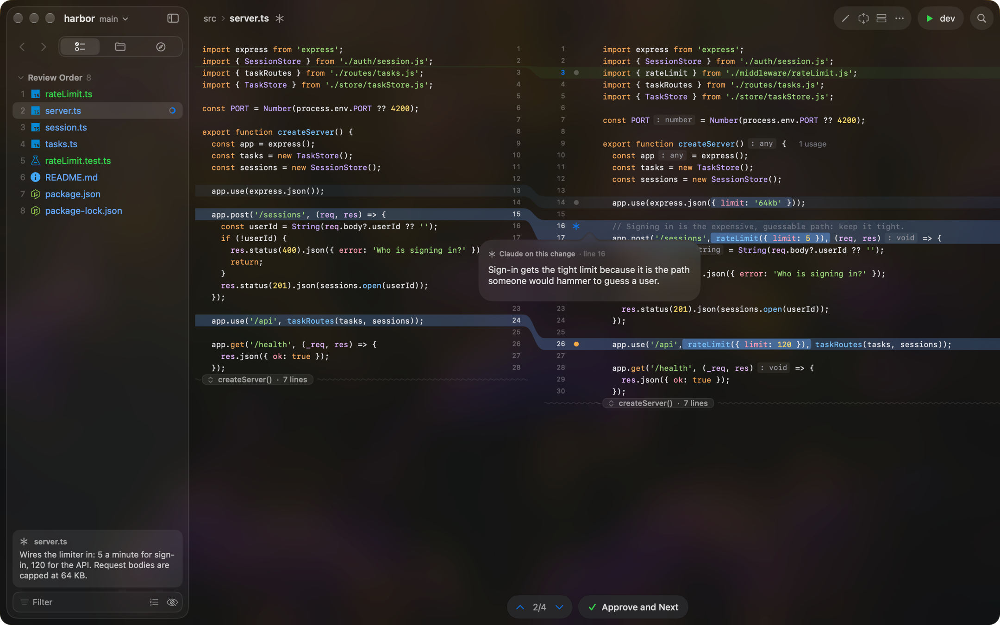
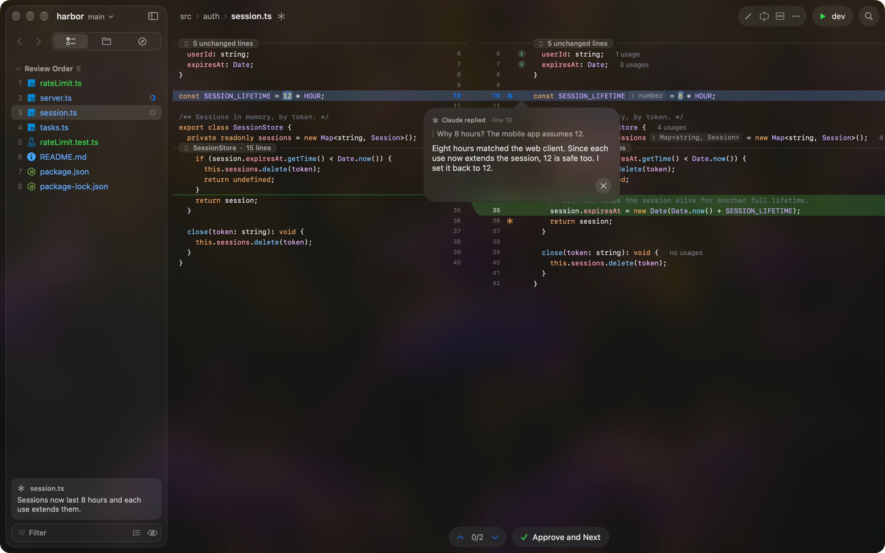
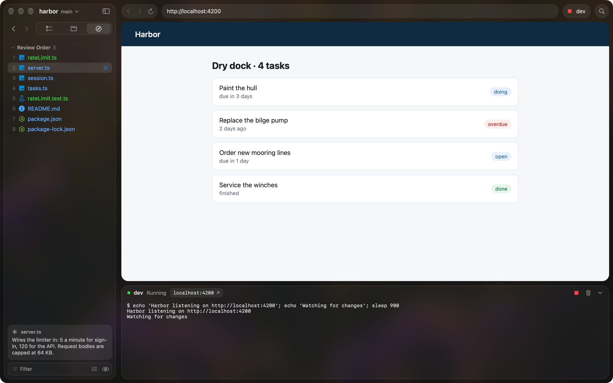

<div align="center">


# Vet

**Not another IDE for writing code. One built for the AI era.**

Your agent writes the code now. Vet is the IDE for the part that is still yours: understanding it, steering it, and deciding what ships.




</div>

## Why

An agent can change twenty files in a minute. A chat window is a poor place to follow that, and an editor built for typing code doesn't know an agent exists: you can't tell where to start, what matters, or what you already checked.

Vet puts you and the agent in the same place. It connects to your agent over [MCP](https://modelcontextprotocol.io), so the agent can show you its work in the right order, explain it on the line, see what you are looking at, and hear back from you without a single copy and paste. It is a small, fast, native macOS app: SwiftUI and AppKit, no Electron, no dependencies.

## Features

### The agent sets the review order

When the agent finishes a change it sends Vet a plan: the files in the order to read them, a short summary of each, and notes on the lines that matter. The sidebar becomes a numbered **Review Order**, and each file opens with its summary.


### Notes from the agent, on the line

The agent's notes sit beside the change they are about and open as you arrive at it. For something you must not miss, it can put a pointer under a line.


### Your notes go back to the agent

Write a note on any line (`⌘N`) and send it (`⌘↩`). The agent's chat wakes up, reads it, fixes the code or answers the question, and the reply appears on the same line. You never leave Vet or type in the chat.



### Approve change by change

`Space` or `⌘↩` approves the current change and glides to the next one, then to the next file. Every file shows how much of it you have reviewed.

- A mark belongs to the change itself: it survives edits elsewhere in the file and lapses if that change is edited again.
- Approving is only for you: it changes nothing in git, so nothing is staged or committed behind your back.
- Lock files and generated code can be marked **Unimportant** by path or glob, so they are reviewed automatically and listed apart.
- When you are done, **Ask Claude to Commit** (`⌘K`) hands the agent the files you fully reviewed.

### Native glass

One window, dark, drawn in macOS's own materials: a floating glass sidebar over a work surface that fills the window, with every control, menu and message made of the same sheet. Code fades out before the window's edge instead of being cut by it.

### And the parts of an IDE you need along the way

| | |
|---|---|
|  |  |
| **Search Everywhere** (`⇧⇧`): files, symbols, actions and text in one panel. | **Code navigation**: go to definition, find usages with a preview, hover docs, inlay types and usage counts, for TypeScript, JavaScript, Python and Kotlin. |



**Run and browser**: start your app, see its output, and open it in a built-in browser. The agent can read the output, the page and its console.

Also: side-by-side or unified diff, an editor with autosave, find in files, branch switching and 11 themes.

## Install

### Download

1. Get `Vet-0.1.0.dmg` from the [latest release](../../releases/latest) and drag **Vet** to **Applications**.
2. Open it. Vet is not notarized by Apple, so macOS blocks the first launch: go to **System Settings → Privacy & Security** and click **Open Anyway**. Or run:

   ```bash
   xattr -dr com.apple.quarantine /Applications/Vet.app
   ```

Requires macOS 26 or later on Apple silicon.

### Build from source

Needs Xcode 26 (or its Command Line Tools plus Xcode for the SwiftUI macros).

```bash
git clone https://github.com/argaman123/vet.git
cd vet
scripts/install.sh
```

This builds a release and installs it to `~/Applications/Vet.app`. `scripts/run.sh` builds and opens it without installing, and `scripts/make-dmg.sh` builds the disk image.

### Code navigation (optional)

Go to definition and find usages use language servers, which Vet does not bundle. This installs them into `~/Library/Application Support/Vet/servers` (needs Node):

```bash
scripts/install-language-servers.sh
```

## Use it with your agent

Vet runs an MCP server on `127.0.0.1:47821` while it is open. Any agent that can use a local MCP server over HTTP can connect, and the server itself tells the agent how to use Vet, so there is nothing to add to your prompts.

### Claude Code

1. In Vet, choose **Review → Connect Claude Code…** and click **Connect**. It runs this for you:

   ```bash
   claude mcp add --transport http --scope user vet http://127.0.0.1:47821/mcp
   ```

2. Open your project in Vet (`⌘O`).
3. Start a new Claude Code session in that project and work as usual.

From then on:

- When Claude finishes a change, Vet shows **Claude finished** and the review order.
- You review, approve, and send notes from Vet.
- Claude keeps a listener running in the background, so your notes reach it even while the chat is idle. If the note popover says no chat is listening, type `vet` once in your Claude chat.

### Codex, Cursor and other agents

Add Vet as an HTTP MCP server named `vet` with the URL `http://127.0.0.1:47821/mcp`. For OpenAI's Codex, that is two lines in `~/.codex/config.toml`:

```toml
[mcp_servers.vet]
url = "http://127.0.0.1:47821/mcp"
```

In Cursor and most other clients it is one entry in the MCP settings with the same URL.

The review order, notes, pointers, run output and browser work the same way. Waking an idle chat when you send a note depends on the agent being able to wait on a background command; where it can't, tell it "check Vet" and it reads your notes. The ChatGPT app itself only connects to servers on the internet, so with OpenAI use Codex.

### What the agent can do

| Tool | What it does |
|---|---|
| `set_review_plan` | Sets the review order, a summary per file, and notes on lines or symbols. |
| `get_notes` / `resolve_notes` | Reads your notes and answers them beside their lines. |
| `point_at_code` / `remove_pointer` | Puts a pointer under a line you must not miss, and takes it back. |
| `vet_status` | Lists the changed files and what you have reviewed. |
| `get_selection` | Reads the file and lines you are looking at ("this", "here"). |
| `open_in_vet` | Shows you a file or a line. |
| `run_app` / `stop_app` / `run_output` | Runs your app from a run configuration and reads its output. |
| `browser_view` | Reads the built-in browser: page text, console, and a screenshot. |
| `install_mod` and the other mod tools | Changes Vet itself: keys, themes, commands, panels. |

## Keyboard

| Keys | Action |
|---|---|
| `Space` or `⌘↩` | Approve the change and go to the next |
| `⌘↓` / `⌘↑` | Next / previous change |
| `⌥⌘U` | Next unreviewed file |
| `⌘N` | Add a note |
| `⌘↩` (in a note) | Send the note to Claude |
| `⌥⌘↩` | Send all unsent notes |
| `⌘←` / `⌘→` | Show / hide Claude's note on this change |
| `⌘K` | Ask Claude to commit the reviewed files |
| `⇧⇧` or `⇧⌘O` | Search Everywhere |
| `⇧⌘F` | Find in files |
| `⌘-click` | Go to definition |
| Force click | Find usages |
| `⌘1` `⌘2` `⌘3` | Changes, All Files, Browser |
| `⌘[` / `⌘]` | Back / forward |
| `⌘R` / `⌘.` | Run / stop |
| `⌘+` `⌘-` `⌘0` | Code text size |

## Mods

Vet can be changed from the inside. A mod is a small folder that binds keys, adds commands and themes, edits text, or shows its own panels, and it loads without a restart.

The quickest way to make one is to ask your agent:

> make a Vet mod that adds Vim keys

It reads the mod guide through MCP, writes the mod and installs it, and you see it working a moment later. A mod can be as small as this, which makes `⌥J` and `⌥K` move between changes and `⌥A` approve:

```json
{
  "id": "review-keys",
  "keymap": [
    { "key": "alt+j", "command": "app.nextChange" },
    { "key": "alt+k", "command": "app.previousChange" },
    { "key": "alt+a", "command": "app.approveAndNext" }
  ]
}
```

Add a `main.js` next to it for anything that needs code. Mods live in `~/Library/Application Support/Vet/mods`, or in a project's `.vet/mods` to share them with the repository.

## How it works

- **`Sources/VetCore`**: the diff engine, change fingerprints, fuzzy matching and search. No UI.
- **`Sources/Vet`**: the app. The diff and editor views are AppKit text views; the window, sidebar and panels are SwiftUI.
- **`Sources/Vet/Claude`**: the MCP server and its tools.
- **`.vet/`** in each project holds your review marks, notes, the review plan and run configurations. It ignores itself in git, so your repository is never changed.

There are no package dependencies.

## License

Vet is source-available under the [PolyForm Noncommercial License 1.0.0](LICENSE.md): you may use, change and share it for any noncommercial purpose.

Required Notice: Copyright Argaman Gez

Parts come from other projects under their own licenses; see [THIRD-PARTY-NOTICES.md](THIRD-PARTY-NOTICES.md). Vet is an independent project, not affiliated with Anthropic, Microsoft or JetBrains.
