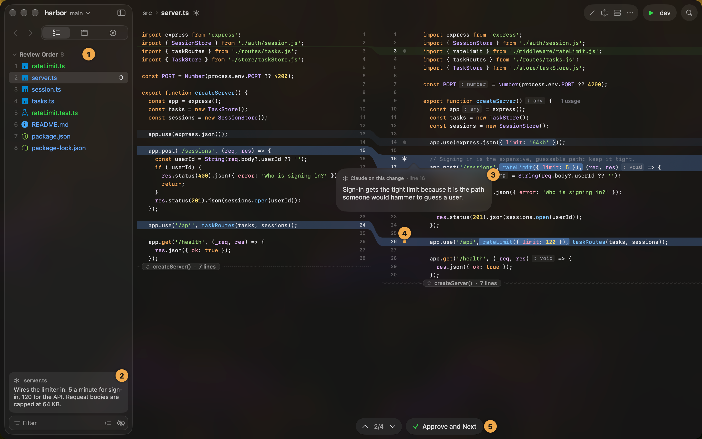
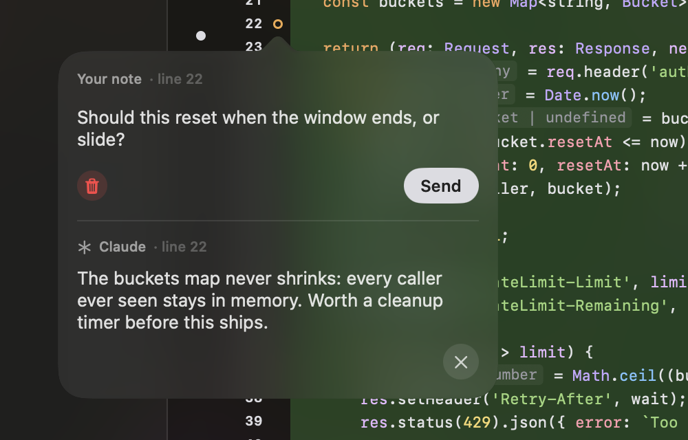
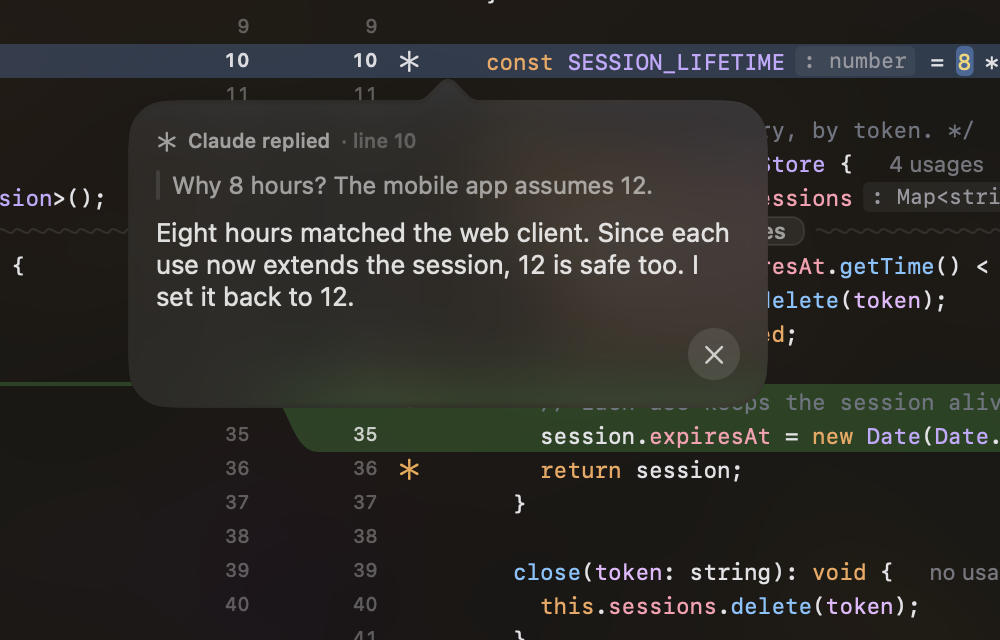

<div align="center">


# Vet

**An IDE for not writing code.**

You stopped writing code months ago, but you're still using that one IDE.<br>
Vet is made for how you now work, and your agent communicates with it directly. Dig into the results and note what needs fixing, without ever needing to leave the code.


</div>



1. **Review order.** Your agent sets the files to read, in the order that makes sense.
2. **File summary.** What changed in the open file, in a line.
3. **Agent's notes.** Waiting beside the changes you shouldn't miss.
4. **Change dot.** Amber when new, white once seen, dim once approved. Click it to approve.
5. **Approve and Next.** `Space` approves and jumps to the next change. `⌘K` asks the agent to commit what you approved.

- **It talks to your agent.** Over [MCP](https://modelcontextprotocol.io): the agent hands you its work in order, explains it, and answers your notes on the line.
- **It's made for reading changes.** Every change is a diff you read and approve, one at a time.
- **It's native and light.** SwiftUI and AppKit. No Electron, no dependencies.

## Answer on the line

`⌘N` writes a note, `⌘↩` sends it. Your agent fixes it while you keep reading, and replies in the same place.

| | |
|---|---|
|  |  |

## Also in Vet

- **Search Everywhere** (`⇧⇧`): files, symbols, actions and text in one panel.
- **Code navigation**: go to definition, find usages, hover docs and inlay types for TypeScript, JavaScript, Python and Kotlin.
- **Run and browser**: start your app, see its output, and open it in a built-in browser. The agent reads the output, the page and its console.
- **[Mods](#mods)**: ask your agent to change Vet itself: keys, commands, themes, panels.
- Side-by-side or unified diff, an editor with autosave, find in files, branches, and macOS's own Liquid Glass.

## Install

### Download

1. Get `Vet-0.2.1.dmg` from the [latest release](../../releases/latest) and drag **Vet** to **Applications**.
2. Open it. Vet is not notarized by Apple, so macOS blocks the first launch: go to **System Settings → Privacy & Security** and click **Open Anyway**. Or run:

   ```bash
   xattr -dr com.apple.quarantine /Applications/Vet.app
   ```

Requires macOS 26 or later on Apple silicon.

### Build from source

Needs Xcode 26 (or its Command Line Tools plus Xcode for the SwiftUI macros).

```bash
git clone https://github.com/argaman123/vet.git
cd vet
scripts/install.sh
```

This builds a release and installs it to `~/Applications/Vet.app`. `scripts/run.sh` builds and opens it without installing, and `scripts/make-dmg.sh` builds the disk image.

### Code navigation (optional)

Go to definition and find usages use language servers, which Vet does not bundle. This installs them into `~/Library/Application Support/Vet/servers` (needs Node):

```bash
scripts/install-language-servers.sh
```

## Use it with your agent

Vet runs an MCP server on `127.0.0.1:47821` while it is open. Any agent that can use a local MCP server over HTTP can connect, and the server itself tells the agent how to use Vet, so there is nothing to add to your prompts.

### Claude Code

1. In Vet, choose **Review → Connect Claude Code…** and click **Connect**. It runs this for you:

   ```bash
   claude mcp add --transport http --scope user vet http://127.0.0.1:47821/mcp
   ```

2. Open your project in Vet (`⌘O`).
3. Start a new Claude Code session in that project and work as usual.

From then on:

- When Claude finishes a change, Vet shows **Claude finished** and the review order.
- You review, approve, and send notes from Vet.
- Claude keeps a listener running in the background, so your notes reach it even while the chat is idle. If a note stays waiting, type `vet` once in your Claude chat.

### Codex, Cursor and other agents

Add Vet as an HTTP MCP server named `vet` with the URL `http://127.0.0.1:47821/mcp`. For OpenAI's Codex, that is two lines in `~/.codex/config.toml`:

```toml
[mcp_servers.vet]
url = "http://127.0.0.1:47821/mcp"
```

In Cursor and most other clients it is one entry in the MCP settings with the same URL.

The review order, notes, pointers, run output and browser work the same way, and Vet calls the agent by its own name. Waking an idle chat when you send a note depends on the agent being able to wait on a background command; where it can't, tell it "check Vet" and it reads your notes. The ChatGPT app itself only connects to servers on the internet, so with OpenAI use Codex.

### What the agent can do

| Tool | What it does |
|---|---|
| `set_review_plan` | Sets the review order, a summary per file, and notes on lines or symbols. |
| `get_notes` / `resolve_notes` | Reads your notes and answers them beside their lines. |
| `point_at_code` / `remove_pointer` | Puts a pointer under a line you must not miss, and takes it back. |
| `vet_status` | Lists the changed files and what you have reviewed. |
| `get_selection` | Reads the file and lines you are looking at ("this", "here"). |
| `open_in_vet` | Shows you a file or a line. |
| `run_app` / `stop_app` / `run_output` | Runs your app from a run configuration and reads its output. |
| `browser_view` | Reads the built-in browser: page text, console, and a screenshot. |
| `install_mod` and the other mod tools | Changes Vet itself: keys, themes, commands, panels. |

## Keyboard

| Keys | Action |
|---|---|
| `Space` or `⌘↩` | Approve the change and go to the next |
| `⌘↓` / `⌘↑` | Next / previous change |
| `⌥⌘U` | Next unreviewed file |
| `⌘N` | Add a note |
| `⌘↩` (in a note) | Send the note to the agent |
| `⌥⌘↩` | Send all unsent notes |
| `⌘←` / `⌘→` | Show / hide the agent's note on this change |
| `⌘K` | Ask the agent to commit the reviewed files |
| `⇧⇧` or `⇧⌘O` | Search Everywhere |
| `⇧⌘F` | Find in files |
| `⌘-click` | Go to definition |
| Force click | Find usages |
| `⌘1` `⌘2` `⌘3` | Changes, All Files, Browser |
| `⌘[` / `⌘]` | Back / forward |
| `⌘R` / `⌘.` | Run / stop |
| `⌘+` `⌘-` `⌘0` | Code text size |

## Mods

Vet can be changed from the inside, and you don't write anything to do it. Ask your agent:

> make a Vet mod that adds Vim keys

> add a panel that shows the failing tests next to the diff

> give me a warmer theme

It builds the mod and installs it, and Vet picks it up without a restart. Mods can bind keys, add commands and themes, edit text, and show their own panels.

## Project layout

- **`Sources/VetCore`**: the diff engine, change fingerprints, fuzzy matching and search. No UI.
- **`Sources/Vet`**: the app. The diff and editor views are AppKit text views; the window, sidebar and panels are SwiftUI.
- **`Sources/Vet/Claude`**: the MCP server and its tools.
- **`.vet/`** in each project holds your review marks, notes, the review plan and run configurations. It ignores itself in git, so your repository is never changed.

There are no package dependencies.

## License

Vet is source-available under the [PolyForm Noncommercial License 1.0.0](LICENSE.md): you may use, change and share it for any noncommercial purpose.

Required Notice: Copyright Argaman Gez

Parts come from other projects under their own licenses; see [THIRD-PARTY-NOTICES.md](THIRD-PARTY-NOTICES.md). Vet is an independent project, not affiliated with Anthropic, Microsoft or JetBrains.
