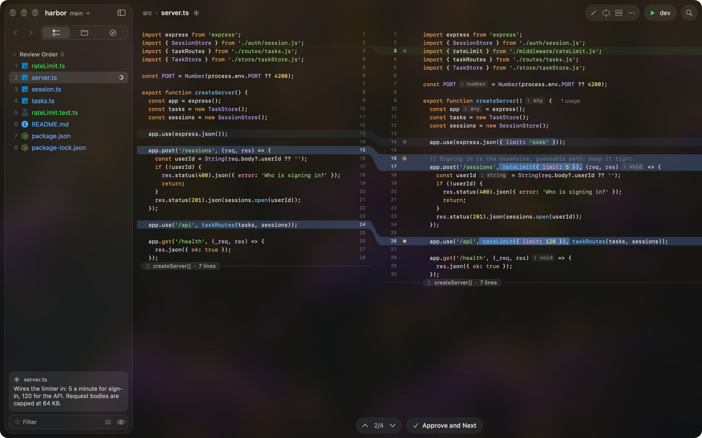
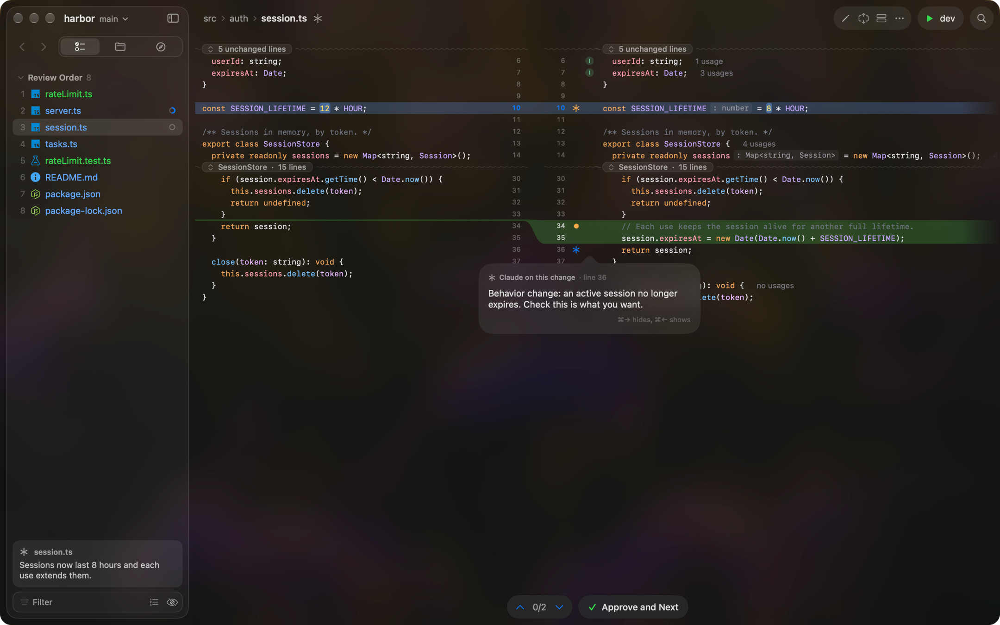

<div align="center">


# Vet

**A native Mac app for reviewing the code your AI agent writes.**

Your agent tells Vet what to read and in what order. You approve change by change, leave notes on lines, and the agent answers them beside the code.


</div>

## Why

An agent can change twenty files in a minute. Reading them in a chat window, or in an editor built for writing code, is slow: you don't know where to start, what matters, or what you already checked.

Vet is built for that one job. It is a small, fast, native macOS app (SwiftUI and AppKit, no Electron, no dependencies) that connects to Claude Code over [MCP](https://modelcontextprotocol.io) and turns "here is a diff" into a guided review.

## Features

### The agent sets the review order

When Claude finishes a change it sends Vet a plan: the files in the order to read them, a short summary of each, and notes on the lines that matter. The sidebar becomes a numbered **Review Order**, and each file opens with its summary.



### Notes from the agent, on the line

Claude's notes sit beside the change they are about and open as you arrive at it. For something you must not miss, Claude can put a pointer under a line.



### Your notes go back to the agent

Write a note on any line (`⌘N`) and send it (`⌘↩`). The Claude Code chat that is listening wakes up, reads it, fixes the code or answers the question, and the reply appears on the same line. You never leave Vet or type in the chat.


### Approve change by change

`Space` or `⌘↩` approves the current change and glides to the next one, then to the next file. Every file shows how much of it you have reviewed.

- A mark belongs to the change itself: it survives edits elsewhere in the file and lapses if that change is edited again.
- Marks are Vet's own. Git's staging area is never touched.
- Lock files and generated code can be marked **Unimportant** by path or glob, so they are reviewed automatically and listed apart.
- **Ask Claude to Commit** hands the agent the list of fully reviewed files to commit.

### Native glass

One window, dark, drawn in macOS's own materials: a floating glass sidebar over a work surface that fills the window, with every control, menu and message made of the same sheet. Code fades out before the window's edge instead of being cut by it.

### And the parts of an IDE you need while reviewing

| | |
|---|---|
|  |  |
| **Search Everywhere** (`⇧⇧`): files, symbols, actions and text in one panel. | **Code navigation**: go to definition, find usages with a preview, hover docs, inlay types and usage counts, for TypeScript, JavaScript, Python and Kotlin. |
|  | |
| **Run and browser**: start your app, see its output, and open it in a built-in browser. Claude can read the output, the page and its console through MCP. | **Also**: side-by-side or unified diff, an editor with autosave, find in files, branch switching, 11 themes, and mods. |

## Install

### Download

1. Get `Vet-0.1.0.dmg` from the [latest release](../../releases/latest) and drag **Vet** to **Applications**.
2. Open it. Vet is not notarized by Apple, so macOS blocks the first launch: go to **System Settings → Privacy & Security** and click **Open Anyway**. Or run:

   ```bash
   xattr -dr com.apple.quarantine /Applications/Vet.app
   ```

Requires macOS 26 or later on Apple silicon.

### Build from source

Needs Xcode 26 (or its Command Line Tools plus Xcode for the SwiftUI macros).

```bash
git clone https://github.com/argaman123/vet.git
cd vet
scripts/install.sh
```

This builds a release and installs it to `~/Applications/Vet.app`. `scripts/run.sh` builds and opens it without installing, and `scripts/make-dmg.sh` builds the disk image.

### Code navigation (optional)

Go to definition and find usages use language servers, which Vet does not bundle. This installs them into `~/Library/Application Support/Vet/servers` (needs Node):

```bash
scripts/install-language-servers.sh
```

## Use it with Claude Code

Vet runs an MCP server on `127.0.0.1:47821` while it is open.

1. In Vet, choose **Review → Connect Claude Code…** and click **Connect**. It runs this for you:

   ```bash
   claude mcp add --transport http --scope user vet http://127.0.0.1:47821/mcp
   ```

2. Open your project in Vet (`⌘O`).
3. Start a new Claude Code session in that project and work as usual.

The server tells Claude how to use Vet, so there is nothing to add to your prompts. From then on:

- When Claude finishes a change, Vet shows **Claude finished** and the review order.
- You review, approve, and send notes from Vet.
- Claude keeps a listener running in the background, so your notes reach it even while the chat is idle. If the note popover says no chat is listening, type `vet` once in your Claude chat.

### What the agent can do

| Tool | What it does |
|---|---|
| `set_review_plan` | Sets the review order, a summary per file, and notes on lines or symbols. |
| `get_notes` / `resolve_notes` | Reads your notes and answers them beside their lines. |
| `point_at_code` / `remove_pointer` | Puts a pointer under a line you must not miss, and takes it back. |
| `vet_status` | Lists the changed files and what you have reviewed. |
| `get_selection` | Reads the file and lines you are looking at ("this", "here"). |
| `open_in_vet` | Shows you a file or a line. |
| `run_app` / `stop_app` / `run_output` | Runs your app from a run configuration and reads its output. |
| `browser_view` | Reads the built-in browser: page text, console, and a screenshot. |
| `install_mod` and the other mod tools | Changes Vet itself: keys, themes, commands, panels. |

Any MCP client that speaks streamable HTTP can use the same server.

## Keyboard

| Keys | Action |
|---|---|
| `Space` or `⌘↩` | Approve the change and go to the next |
| `⌘↓` / `⌘↑` | Next / previous change |
| `⌥⌘U` | Next unreviewed file |
| `⌘N` | Add a note |
| `⌘↩` (in a note) | Send the note to Claude |
| `⌥⌘↩` | Send all unsent notes |
| `⌘←` / `⌘→` | Show / hide Claude's note on this change |
| `⌘K` | Ask Claude to commit the reviewed files |
| `⇧⇧` or `⇧⌘O` | Search Everywhere |
| `⇧⌘F` | Find in files |
| `⌘-click` | Go to definition |
| Force click | Find usages |
| `⌘1` `⌘2` `⌘3` | Changes, All Files, Browser |
| `⌘[` / `⌘]` | Back / forward |
| `⌘R` / `⌘.` | Run / stop |
| `⌘+` `⌘-` `⌘0` | Code text size |

## Mods

A mod is a folder with a `mod.json` and an optional `main.js`. It can bind keys, add commands and themes, edit text, and show panels, and it loads without a restart. Mods live in `~/Library/Application Support/Vet/mods`, or in a project's `.vet/mods`.

The quickest way to make one is to ask Claude: "make a Vet mod that adds Vim keys". It reads the mod guide through MCP and installs the mod for you.

## How it works

- **`Sources/VetCore`**: the diff engine (a Swift port of VS Code's), change fingerprints, fuzzy matching and search. No UI, covered by tests (`scripts/test.sh`).
- **`Sources/Vet`**: the app. The diff and editor views are AppKit text views; the window, sidebar and panels are SwiftUI.
- **`Sources/Vet/Claude`**: the MCP server and its tools.
- **`.vet/`** in each project holds your review marks, notes, the review plan and run configurations. It ignores itself in git, so your repository is never changed.

There are no package dependencies.

## License

Vet is source-available under the [PolyForm Noncommercial License 1.0.0](LICENSE.md): you may use, change and share it for any noncommercial purpose.

Required Notice: Copyright Argaman Gez

Parts come from other projects under their own licenses; see [THIRD-PARTY-NOTICES.md](THIRD-PARTY-NOTICES.md). Vet is an independent project, not affiliated with Anthropic, Microsoft or JetBrains.
